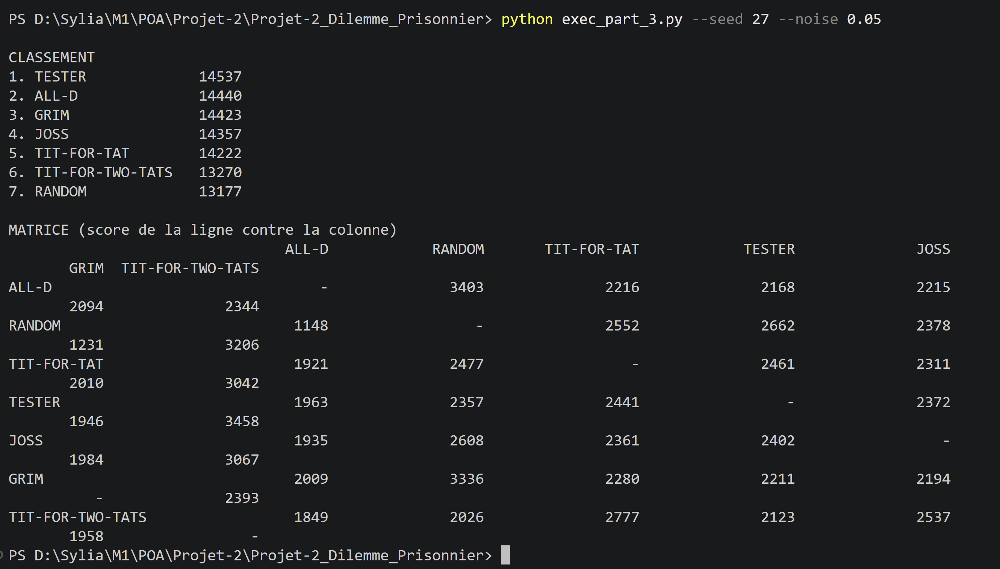
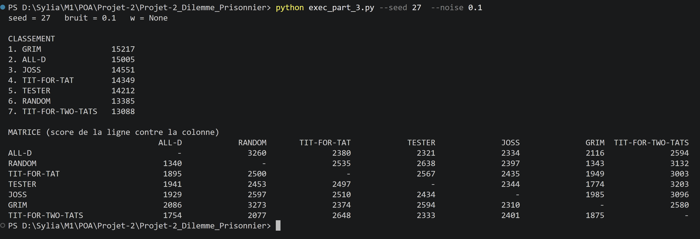
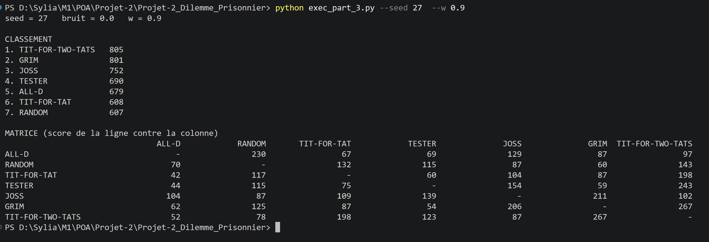
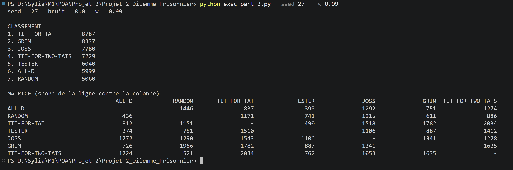
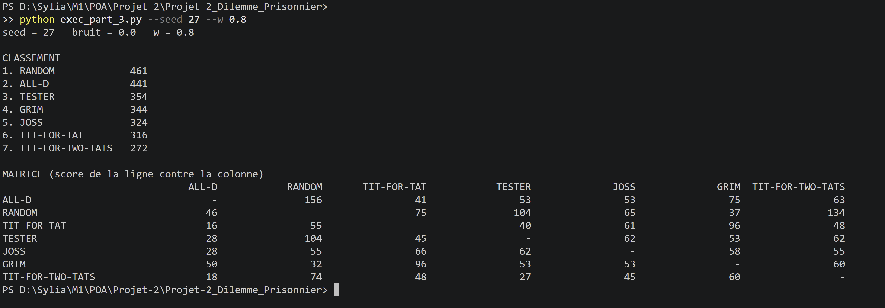
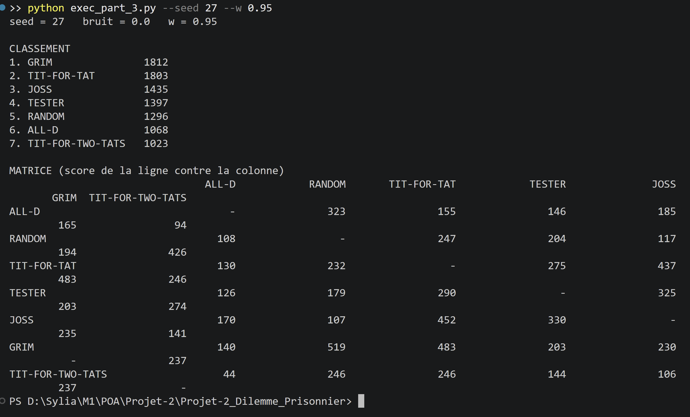
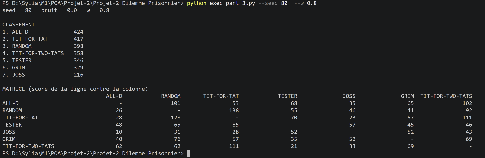

# Journal
## Partie 1
### Le protocole:

Nombre de tours : 200 \
Nombre de parties : 5  \
Format : tournoi tous contre tous, chaque paire de stratégies distinctes joue une fois 5 parties de 200 tours.\
**Valeurs des paramétres :** \
Matrice de gains : donné dans l'énoncé \
Graine : 27 (paramétrable)\
Ordre des stratégies: ALL-D, RANDOM, TIT-FOR-TAT, TESTER, JOSS\
**Paramétres propres aux stratégies:**\
ALL-D: aucun paramètre elle joue toujours D \
RANDOM: probabilité de jouer C = 0,5 (on tire rng.random si < 0,5 elle joue C, sinon D)\
JOSS : probabilité de remplacer C par D = 0,1 (une fois sur 10) .Elle calcule d'abord le coup de TFT,si c'est C elle tire rng.random et joue D si le nombre est < 0,1. Si TFT aurait joué D, elle joue D sans tirage.Le test s'applique aussi au tour 1.\
TIT-FOR-TAT: premier coup C, puis à chaque tour elle rejoue le dernier coup de l'adversaire (opp[-1])\
TESTER: tour 1 = D (provocation)puis tour 2 = C (on observe la réaction). Si l'adversaire a joué D au tour 2(riposte)  TESTER joue comme TIT-FOR-TAT ensuite. Sinon il répète C, C, D (un D tous les trois tours à partir du tour 4)\
 **Résultats :**
 
Ici, c'est ALL-D qui gagne et TFT est deuxiéme.En comparant TFT et ALL-D adversaire par adversaire nous constatons que l'avance de ALL-D vient quasiment de RANDOM ( un écart de 923 contre TFT) car ALL-D exploite sa coopération ( 1 fois sur deux), il prend 5 points quand RANDOM joue C et 2c quand il joue D soit 3,5 en moyenne par tour là où TFT prend en moyenne 2,5 par tour (comme TFT copie le coup précédent de RANDOM et que ce coup est indépendant de celui que RANDOM joue au tour courant, donc les quatre combinaisons (C,C), (C,D), (D,C),
(D,D) ont la même probabilité; D'où Le gain moyen de TFT  (3 + 0 + 5 + 2) / 4 = 2,5
points par tour). TFT marque plus contre TESTER et JOSS comparé à ALL-D mais ça ne compense pas l'écart avec RANDOM.
Parmi les cinq stratégies, seule TFT est « gentille » au sens d'Axelrod (elle
ne trahit jamais la première). ALL-D, RANDOM, TESTER et JOSS peuvent trahir en
premier. TFT ne rencontre donc aucune stratégie coopérative.
## Partie 2 
**Les 2 stratégies choisies:** \([source ](https://www.prisoners-dilemma.com/common-strategy/))\
Grim trigger: elle coopère jusqu'à la première trahison puis D pour toujours, elle devrait être bonne avec les stratégies qui ne trahissent pas en premier vu qu'elle va coopérer avec elles tout au long.\
Tit fir Two Tats: coopére et ne joue D que si l'adversaire a joué D deux fois de suite. Bonne face à des stratégies  coopératives  mais moins bonne avec celles qui trahissent de façon isolée (TEST, JOSS,RANDOM) vu qu'elle ne reposte pas à une trahison seule donc les autres stratégies en profitent.\
**Résultats:**

 Les stratégies "gentilles" (GRIM, TFT, TFTT), qui ne
trahissent jamais en premier, occupent le haut du classement. Elles font 3000
entre elles (coopération parfaite). ALL-D qui n'exploite que RANDOM, est
avant-dernier. Ceci confirme que TFT manquait d'adversaires coopératifs à
l'étape 1.

**Comparaison avec l'étape 1 :**
ALL-D passe de la 1re à la 6e place. TFT reste 2e, mais devant ALL-D au lieu
de derrière. GRIM la devance (+564) car, en plus de coopérer à 3000 avec les
stratégies gentilles, elle exploite RANDOM comme ALL-D (3542 contre 2496 pour
TFT). 
## Partie 3

## Justification du choix des deux modifications
**Bruit :** à l'étape 2, GRIM et TIT-FOR-TWO-TATS ont réagi très différemment aux trahisons (GRIM ne pardonne jamais, TFTT ignore une trahison isolée). Le bruit introduit des trahisons accidentelles, donc je veux voir laquelle de mes stratégies y résiste le mieux.

**Horizon inconnu :** le tournoi de base suppose une durée fixe et connue de 200 tours. avec un horizon inconnu, la partie continue avec une probabilité w, ce qui permet de voir si le classement change quand on ne sait plus quand elle s'arrête.

## Modification 1 : bruit

À chaque tour, chaque joueur a 5 % de chances que son coup soit inversé (C devient D, ou D devient C). Le coup inversé est celui qui est vraiment joué, il compte dans les gains et il apparaît dans l'historique, donc les deux joueurs le voient. Les deux joueurs sont tirés séparément.

**Prédiction**
 Avec environ 10 erreurs par joueur et par partie, la capacité à
  pardonner devient décisive. GRIM est la plus pénalisée, dans le sens où une seule inversion (la sienne ou celle de l'adversaire) lui fait voir un D, et elle joue D pour toujours ça lui fait perdre la coopération.TFTT devrait être la plus robuste, une seule trahison isolée ne la fait pas riposter. ALL-D devrait peu changer, il joue D de toute façon, et le bruit ne fait que lui
    faire jouer C par erreur de temps en temps.
- Classement attendu : 1 TIT-FOR-TWO-TATS, 2 TIT-FOR-TAT, 3 TESTER, 4 JOSS, 
  et la 3 derniéres places entre RANDOM, Grim et ALL-D.

## Modification 2 : horizon inconnu

Après chaque tour, la partie continue avec la probabilité w et s'arrête sinon. La durée moyenne est 1 / (1 − w) tours. Comme les parties n'ont plus la même longueur, je compare les classements, pas les totaux de points.
 
**Prédiction**
le poids du premier tour change. Dans une partie courte, le 5 gagné en trahissant au tour 1 compte beaucoup plus. ALL-D et TESTER devraient donc monter quand w diminue, alors que la coopération mutuelle à 3 points par tour (TFT, GRIM, TFTT) a moins le temps de s'installer et d'accumuler l'avance qu'elle avait à l'étape 2.

## Résultats 
### Modification 1 : 
\
\
Variation du total par rapport à l'étape 2 (même graine 27, mêmes 6000 tours par stratégie) :

| Stratégie | Bruit 0,05 | Bruit 0,1 |
|---|---|---|
| ALL-D | +931 | +1496 |
| JOSS | +405 | +599 |
| RANDOM | +216 | +424 |
| TESTER | -42 | -367 |
| GRIM | -1177 | -383 |
| TFT | -814 | -687 |
| TFTT | -1383 | -1565 |

**Comparaison avec ma prédiction**
- Juste : GRIM perd sa coopération (ses 3000 points avec TFT tombent à 2280 avec la graine 27 et à 2252 avec la graine 100). RANDOM finit bien dans les dernières places.
- Fausse sur GRIM comme « la plus pénalisée » : elle reste dans les trois premiers avec les quatre tournois, et son total baisse moins que celui de TFTT.
- Fausse sur TFTT : prédite la plus robuste, elle perd le plus (-1383 et -1565) et finit 6e ou 7e.
- Fausse sur ALL-D : prédit stable, c'est lui qui gagne le plus (+931 et +1496).
- Fausse sur le classement : TFTT, TFT, TESTER, JOSS n'apparaît dans aucun tournoi.

**Explication**
- Le bruit pénalise les stratégies qui reposent sur une coopération stable (TFT, TFTT) car une inversion déclenche des représailles. TFTT pardonne bien, mais sa tolérance est exploitée par TESTER, RANDOM  et JOSS , ce qui lui fait perdre au total.
- ALL-D prend 5 au lieu de 2 chaque fois qu'un adversaire joue C par erreur (2216 contre TFT, au lieu de 2015 sans bruit).
- GRIM tient grâce à son comportement après la première inversion ,elle joue D pour toujours, comme ALL-D. 

**Effet de la graine et limites**
- Les résultats qui se répètent avec toutes les graines et les deux niveaux de bruit : ALL-D dans les deux premiers, GRIM dans les trois premiers, TFTT et RANDOM dans les deux dernières places (dans un ordre qui change), JOSS 3e ou 4e.
- Ce qui ne se répète pas : TESTER est 1er avec la graine 27 (bruit 0,05), puis 5e avec la graine 100 (son score contre GRIM passe de 1946 à 1511). Sa première place venait du hasard des inversions et n'est pas un effet du bruit. L'ordre ALL-D / GRIM et l'ordre TFT / TESTER changent aussi d'une graine à l'autre (écarts de 100 à 200 points, du même ordre que les variations de totaux).

### Modification 2 : horizon inconnu
\
\
\
\
\
**Comparaison avec ma prédiction**
- ALL-D monte quand w diminue : confirmé. Il est 6e à w = 0,99 et 0,95, 5e à 0,9, puis 2e et 1er à 0,8 (graines 27 et 80).
- TESTER monte : pas net. 5e à w = 0,99, 4e à 0,95 et 0,9, puis 3e et 5e à 0,8.
- Les stratégies coopératives perdent de l'avance : seulement en partie. GRIM reste dans les deux premiers jusqu'à w = 0,9 (2e, 1re, 2e) puis tombe à la 4e et 6e place à w = 0,8. TFT est 1re à w = 0,99 et 2e à 0,95, puis 6e à 0,9 et à 0,8 avec la graine 27, mais 2e à 0,8 avec la graine 80. TFTT n'a pas de tendance : 4e (w = 0,99), 7e (0,95), 1re (0,9), puis 7e et 4e (0,8).
- Non prévu : RANDOM ne se place bien que pour w = 0,8 (1er et 3e). Il est 7e à w = 0,99 et 0,9 (à 1 point de TFT) et 5e à 0,95.

**Explication**
- À w = 0,99 (environ 100 tours), le classement est proche de celui de l'étape 2 : la coopération a le temps de s'installer (TFT 1re, GRIM 2e, ALL-D 6e, RANDOM 7e).
- Le mécanisme annoncé se vérifie dans le duel ALL-D contre TFT : ALL-D prend 5 au tour 1 de chaque partie et TFT 0, donc l'écart est toujours de 25 points sur 5 parties (2015 contre 1990 sur 200 tours ; 41 contre 16 et 53 contre 28 à w = 0,8). Ce qui change, c'est son poids : environ 1 % du score sur 200 tours, environ la moitié à w = 0,8.
- Une stratégie qui commence par C prend un 0 face à un adversaire qui trahit au tour 1 et n'a pas le temps de le récupérer avec la coopération (3 points par tour). C'est ce qui fait reculer GRIM à w = 0,8.
- TESTER ne profite pas du poids du premier tour. Hypothèse : il joue D au tour 1 mais C au tour 2, ce qui lui coûte 0 face à un adversaire qui trahit (28 contre 53 pour ALL-D avec la graine 27, 48 contre 68 avec la graine 80).
- RANDOM exploite les stratégies gentilles sans subir de représailles qui comptent en si peu de tours (134 contre 74 face à TFTT, graine 27, w = 0,8).

**Limites**
- La durée de chaque partie est aléatoire, donc chaque paire joue un nombre de tours différent, et cela fausse le classement. À w = 0,95, TFT et GRIM font 483 chacune (environ 161 tours) alors que GRIM et TFTT font 237 (environ 79 tours) : l'écart de 9 points entre GRIM et TFT n'est pas significatif. À w = 0,9, la 1re place de TFTT vient de parties longues avec GRIM (267 points chacune, environ 89 tours) et avec TFT (198, environ 66 tours), alors que la moyenne attendue est de 50 tours par paire. À w = 0,99, TFT et TFTT coopèrent pendant environ 678 tours (2034 points chacune) pour une moyenne attendue de 500.
- À w = 0,8, chaque paire joue environ 25 tours au total et les deux graines donnent des ordres très différents (TFT 6e puis 2e, TFTT 7e puis 4e, JOSS 5e puis 7e).
- Seule la montée d'ALL-D quand w diminue se retrouve de façon régulière. Les autres rangs dépendent beaucoup de la durée tirée au hasard pour chaque paire.
