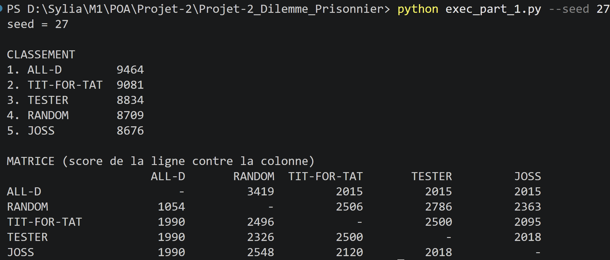

# Journal
## Partie 1
### Le protocole:

Nombre de tours : 200 \
Nombre de parties : 5  \
Format : tournoi tous contre tous, chaque paire de stratégies distinctes joue une fois 5 parties de 200 tours.\
**Valeurs des paramétres :** \
Matrice de gains : donné dans l'énoncé \
Graine : 27 (paramétrable)\
Ordre des stratégies: ALL-D, RANDOM, TIT-FOR-TAT, TESTER, JOSS\
**Paramétres propres aux stratégies:**\
ALL-D: aucun paramètre elle joue toujours D \
RANDOM: probabilité de jouer C = 0,5 (on tire rng.random si < 0,5 elle joue C, sinon D)\
JOSS : probabilité de remplacer C par D = 0,1 (une fois sur 10) .Elle calcule d'abord le coup de TFT,si c'est C elle tire rng.random et joue D si le nombre est < 0,1. Si TFT aurait joué D, elle joue D sans tirage.Le test s'applique aussi au tour 1.\
TIT-FOR-TAT: premier coup C, puis à chaque tour elle rejoue le dernier coup de l'adversaire (opp[-1])\
TESTER: tour 1 = D (provocation)puis tour 2 = C (on observe la réaction). Si l'adversaire a joué D au tour 2(riposte)  TESTER joue comme TIT-FOR-TAT ensuite. Sinon il répète C, C, D (un D tous les trois tours à partir du tour 4)\
 **Résultats :**
 
Ici, c'est ALL-D qui gagne et TFT est deuxiéme.En comparant TFT et ALL-D adversaire par adversaire nous constatons que l'avance de ALL-D vient quasiment de RANDOM ( un écart de 923 contre TFT) car ALL-D exploite sa coopération ( 1 fois sur deux), il prend 5 points quand RANDOM joue C et 2c quand il joue D soit 3,5 en moyenne par tour là où TFT prend en moyenne 2,5 par tour (comme TFT copie le coup précédent de RANDOM et que ce coup est indépendant de celui que RANDOM joue au tour courant, donc les quatre combinaisons (C,C), (C,D), (D,C),
(D,D) ont la même probabilité; D'où Le gain moyen de TFT  (3 + 0 + 5 + 2) / 4 = 2,5
points par tour). TFT marque plus contre TESTER et JOSS comparé à ALL-D mais ça ne compense pas l'écart avec RANDOM.
Parmi les cinq stratégies, seule TFT est « gentille » au sens d'Axelrod (elle
ne trahit jamais la première). ALL-D, RANDOM, TESTER et JOSS peuvent trahir en
premier. TFT ne rencontre donc aucune stratégie coopérative. Et comme TFT réussie plus avec des stratégies coopératives \
## Partie 2 
**Les 2 stratégies choisies:** \([source :](https://www.prisoners-dilemma.com/common-strategy/))\
Grim trigger: elle coopère jusqu'à la première trahison puis D pour toujours, elle devrait être bonne avec les stratégies qui ne trahissent pas en premier vu qu'elle va coopérer avec elles tout au long. \
Tit fir Two Tats: coopére et ne joue D que si l'adversaire a joué D deux fois de suite. Bonne face à des stratégies  coopératives  mais moins bonne avec celles qui trahissent de façon isolée (TEST, JOSS,RANDOM) vu qu'elle ne reposte pas à une trahison seule donc les autres stratégies en profitent.\ 

