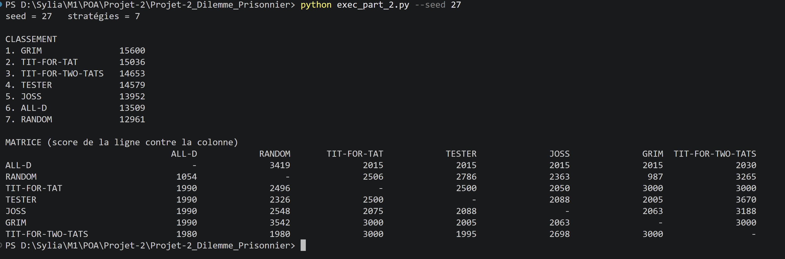

# Journal
## Partie 1
### Le protocole:

Nombre de tours : 200 \
Nombre de parties : 5  \
Format : tournoi tous contre tous, chaque paire de stratégies distinctes joue une fois 5 parties de 200 tours.\
**Valeurs des paramétres :** \
Matrice de gains : donné dans l'énoncé \
Graine : 27 (paramétrable)\
Ordre des stratégies: ALL-D, RANDOM, TIT-FOR-TAT, TESTER, JOSS\
**Paramétres propres aux stratégies:**\
ALL-D: aucun paramètre elle joue toujours D \
RANDOM: probabilité de jouer C = 0,5 (on tire rng.random si < 0,5 elle joue C, sinon D)\
JOSS : probabilité de remplacer C par D = 0,1 (une fois sur 10) .Elle calcule d'abord le coup de TFT,si c'est C elle tire rng.random et joue D si le nombre est < 0,1. Si TFT aurait joué D, elle joue D sans tirage.Le test s'applique aussi au tour 1.\
TIT-FOR-TAT: premier coup C, puis à chaque tour elle rejoue le dernier coup de l'adversaire (opp[-1])\
TESTER: tour 1 = D (provocation)puis tour 2 = C (on observe la réaction). Si l'adversaire a joué D au tour 2(riposte)  TESTER joue comme TIT-FOR-TAT ensuite. Sinon il répète C, C, D (un D tous les trois tours à partir du tour 4)\
 **Résultats :**
 
Ici, c'est ALL-D qui gagne et TFT est deuxiéme.En comparant TFT et ALL-D adversaire par adversaire nous constatons que l'avance de ALL-D vient quasiment de RANDOM ( un écart de 923 contre TFT) car ALL-D exploite sa coopération ( 1 fois sur deux), il prend 5 points quand RANDOM joue C et 2c quand il joue D soit 3,5 en moyenne par tour là où TFT prend en moyenne 2,5 par tour (comme TFT copie le coup précédent de RANDOM et que ce coup est indépendant de celui que RANDOM joue au tour courant, donc les quatre combinaisons (C,C), (C,D), (D,C),
(D,D) ont la même probabilité; D'où Le gain moyen de TFT  (3 + 0 + 5 + 2) / 4 = 2,5
points par tour). TFT marque plus contre TESTER et JOSS comparé à ALL-D mais ça ne compense pas l'écart avec RANDOM.
Parmi les cinq stratégies, seule TFT est « gentille » au sens d'Axelrod (elle
ne trahit jamais la première). ALL-D, RANDOM, TESTER et JOSS peuvent trahir en
premier. TFT ne rencontre donc aucune stratégie coopérative.
## Partie 2 
**Les 2 stratégies choisies:** \([source ](https://www.prisoners-dilemma.com/common-strategy/))\
Grim trigger: elle coopère jusqu'à la première trahison puis D pour toujours, elle devrait être bonne avec les stratégies qui ne trahissent pas en premier vu qu'elle va coopérer avec elles tout au long.\
Tit fir Two Tats: coopére et ne joue D que si l'adversaire a joué D deux fois de suite. Bonne face à des stratégies  coopératives  mais moins bonne avec celles qui trahissent de façon isolée (TEST, JOSS,RANDOM) vu qu'elle ne reposte pas à une trahison seule donc les autres stratégies en profitent.\
**Résultats:**

 Les stratégies "gentilles" (GRIM, TFT, TFTT), qui ne
trahissent jamais en premier, occupent le haut du classement. Elles font 3000
entre elles (coopération parfaite). ALL-D qui n'exploite que RANDOM, est
avant-dernier. Ceci confirme que TFT manquait d'adversaires coopératifs à
l'étape 1.

**Comparaison avec l'étape 1 :**
ALL-D passe de la 1re à la 6e place. TFT reste 2e, mais devant ALL-D au lieu
de derrière. GRIM la devance (+564) car, en plus de coopérer à 3000 avec les
stratégies gentilles, elle exploite RANDOM comme ALL-D (3542 contre 2496 pour
TFT). 
## Partie 3

## Justification du choix des deux modifications
**Bruit :** à l'étape 2, GRIM et TIT-FOR-TWO-TATS ont réagi très différemment aux trahisons (GRIM ne pardonne jamais, TFTT ignore une trahison isolée). Le bruit introduit des trahisons accidentelles, donc je veux voir laquelle de mes stratégies y résiste le mieux.

**Horizon inconnu :** le tournoi de base suppose une durée fixe et connue de 200 tours. avec un horizon inconnu, la partie continue avec une probabilité w, ce qui permet de voir si le classement change quand on ne sait plus quand elle s'arrête.

## Modification 1 : bruit

À chaque tour, chaque joueur a 5 % de chances que son coup soit inversé (C devient D, ou D devient C). Le coup inversé est celui qui est vraiment joué, il compte dans les gains et il apparaît dans l'historique, donc les deux joueurs le voient. Les deux joueurs sont tirés séparément.

**Prédiction**
 Avec environ 10 erreurs par joueur et par partie, la capacité à
  pardonner devient décisive. GRIM est la plus pénalisée, dans le sens où une seule inversion (la sienne ou celle de l'adversaire) lui fait voir un D, et elle joue D pour toujours ça lui fait perdre la coopération.TFTT devrait être la plus robuste, une seule trahison isolée ne la fait pas riposter. ALL-D devrait peu changer, il joue D de toute façon, et le bruit ne fait que lui
    faire jouer C par erreur de temps en temps.
- Classement attendu : 1 TIT-FOR-TWO-TATS, 2 TIT-FOR-TAT, 3 TESTER, 4 JOSS, 
  et la 3 derniéres places entre RANDOM, Grim et ALL-D.

## Modification 2 : horizon inconnu

Après chaque tour, la partie continue avec la probabilité w et s'arrête sinon. La durée moyenne est 1 / (1 − w) tours. Comme les parties n'ont plus la même longueur, je compare les classements, pas les totaux de points.
 
**Prédiction**
le poids du premier tour change. Dans une partie courte, le 5 gagné en trahissant au tour 1 compte beaucoup plus. ALL-D et TESTER devraient donc monter quand w diminue, alors que la coopération mutuelle à 3 points par tour (TFT, GRIM, TFTT) a moins le temps de s'installer et d'accumuler l'avance qu'elle avait à l'étape 2.

